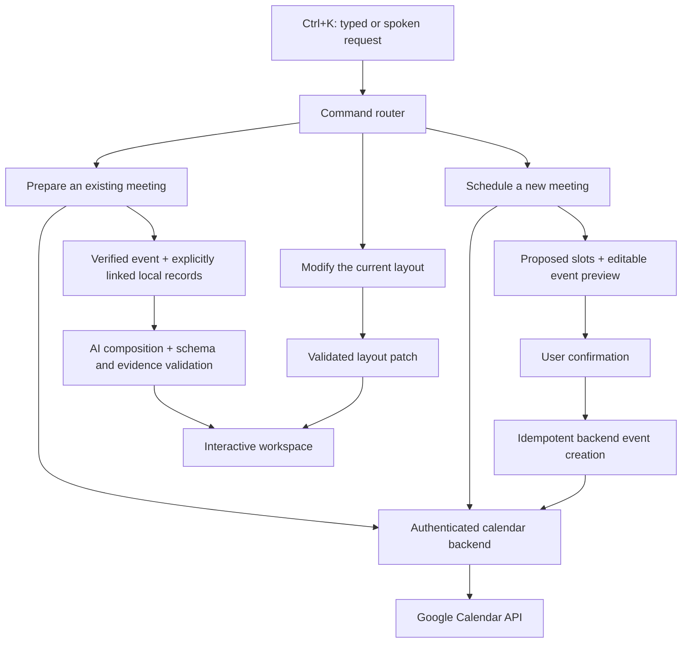

# Orlo — Real Calendar and Adaptive Workspace Implementation Plan

Prepared October 11, 2026. Planning only: no calendar account connection, deployment, or external event creation is part of this task.

## Target outcome and first-provider decision

Implement Google Calendar first through the website's backend. Keep the provider adapter interface open for Outlook later. Support three distinct requests:

1. **Prepare:** “Prepare for tomorrow’s client meeting.” Read an existing event and construct a preparation workspace.
2. **Modify:** “Add my calendar to this workspace.” Change the existing layout while preserving its meeting scope, notes, and filters.
3. **Schedule:** “Arrange a 30-minute meeting with Alex tomorrow.” Collect missing details, propose slots, show a preview, and create the event after explicit confirmation.

A connected calendar supplies event metadata; it does not grant access to email conversations, document contents, or project history. Use separately linked records where available and show missing context honestly.

## Current implementation and reuse

- `client/src/services/calendarIntegrationService.ts`: connection records are local; `connect()` and `sync()` explicitly return unavailable messages.
- `client/src/services/authService.ts`: local-profile selection, without real server authentication.
- `client/server/index.ts` and `client/vite.config.ts`: production and development route registration; both need the same calendar/auth handlers.
- `client/src/hooks/useAdaptiveWorkspace.ts`: structured intent → data → validated composition. Currently rejects unsupported intent before general generation.
- `client/src/domain/intent.ts`: three allowed goal types; no layout modification or scheduling command.
- `client/src/domain/adaptiveData.ts`: meetings require client/project ownership and same-day start/end times. That contract cannot represent arbitrary imported Google events.
- Meeting/usage/overdue composition schemas have separate widget allowlists without calendar.
- Existing browser database, drafts, filters, renderer, speech input, and layout persistence should be reused.

The previous 46 passing domain tests validate existing workflows. They do not cover OAuth, live calendar retrieval, layout modification, or remote event creation.

## Architecture

The model proposes intent and composition. Application code owns authorization, entity lookup, date calculations, layout validation, and external writes.

## Stage 1 — Contracts, real dates, and command routing

**Files:** extend `domain/intent.ts`, add `domain/workspaceCommands.ts`, `domain/calendar.ts`, and `services/clockService.ts`; update `useAdaptiveWorkspace.ts`.

- Introduce a discriminated command: `prepare_meeting`, `modify_workspace`, `schedule_meeting`, `existing_goal`, or `needs_clarification`.
- Keep existing meeting/usage/overdue schemas intact where possible. Route modifications before the three-goal classifier.
- Model modifications as validated operations: add/remove widget, change span/order, set approved filters/date. Every patch includes an expected layout revision.
- Preserve current meeting/project/client bindings by default. A widget addition must not implicitly change the active business goal.
- Distinguish “add calendar” (UI) from “add a meeting to my calendar” (external write). Ambiguous language triggers clarification.
- Make time an injected dependency. Live mode resolves tomorrow from the actual date in the user-selected IANA timezone; demo mode retains the demo date with a visible label. Never use `DEMO_DATE` for live scheduling.
- Define normalized external events with account/calendar/event identity, provider revision, title, description, attendees, organizer, location, conference link, status, recurrence-instance identity, and either timed start/end or all-day dates.
- Retain timezone and original timestamps. Support events crossing midnight and multi-day/all-day events; do not force them into the old same-day `Meeting` schema.
- Calendar-only preparation permits missing client/project associations. Explicit links enrich context; never create fake clients/projects to satisfy validation.

**Exit gate:** schema and routing tests show “add calendar” is accepted, “schedule a meeting” is a different command, and live tomorrow resolves correctly across timezone boundaries.

## Stage 2 — Real sessions and Google OAuth

**New server modules:** `server/auth/session.ts`, `server/auth/googleOAuth.ts`, `server/calendar/googleProvider.ts`, and a persistent connection/token repository.

**Endpoints:**

| Endpoint | Purpose |
|---|---|
| `GET /api/auth/session` | Current authenticated identity |
| `GET /api/calendar/connections` | Account, granted capabilities, selected calendars, and sync state |
| `GET /api/calendar/google/connect` | Start authorization bound to the browser session |
| `GET /api/calendar/google/callback` | Validate OAuth state, exchange code, save connection |
| `POST /api/calendar/google/disconnect` | Revoke access, remove stored tokens and invalidate that account’s cache |

- Register a Google OAuth web application and exact development/production callback URLs.
- Authenticate the account using verified Google identity, or attach the calendar to an already authenticated server user. Local profile IDs must not authorize backend access.
- Start with event read access; add calendar-list read access only if calendar selection is included. Check actual granted scopes rather than assuming all requested access was accepted.
- Request offline access for refresh and store encrypted credentials server-side. Use an opaque HttpOnly session cookie, HTTPS in production, OAuth state validation, expiry, and CSRF protection on state-changing routes.
- Introduce durable backend storage for identities, sessions, connections, token metadata, and later command receipts. A single-instance development deployment can use SQLite; hosted deployment must have durable storage. Browser localStorage remains for nonsensitive UI drafts/preferences, not OAuth tokens.
- Add server-only environment settings: Google client ID/secret, redirect URI, application origin, token-encryption key, and storage configuration. Extend `.env.example` with empty placeholders.
- Use one reusable route handler registration for Vite and production so authentication behavior cannot drift.

Google documents server-side authorization-code flow, refresh tokens, state, and incremental authorization. Scope selection should follow the actual read/write feature being requested. [OAuth web-server flow](https://developers.google.com/identity/protocols/oauth2/web-server), [Calendar scopes](https://developers.google.com/workspace/calendar/api/auth).

**Exit gate:** test account connects, remains connected after server restart, refreshes expired access, and disconnects. Another session cannot read its tokens or events.

## Stage 3 — Calendar reading and synchronization

**Files:** replace the placeholder calendar service with an HTTP-backed adapter; add server event normalization, event cache, sync handler, and connection settings UI.

**Endpoints:** `GET /api/calendar/events?from=...&to=...`, `GET /api/calendar/events/:id`, and `POST /api/calendar/sync`.

- Import the primary calendar first; add selected-calendar support after the first flow works.
- Fetch an explicit timezone-correct date window, follow pagination, and expand recurrence instances for the displayed period.
- Preserve stable account/calendar/provider-event IDs. Repeated imports update records without duplication; imported events remain distinct from local demo events.
- Respect cancelled events, changed recurrence instances, attendee response status, all-day events, and multi-day boundaries.
- Use manual refresh and bounded on-open refresh for MVP. Persist sync cursors per account/calendar/query configuration; implement full-resync recovery for expired cursors. Do not mix incompatible bounded-window queries with incremental sync parameters.
- Display last successful refresh and stale/unavailable status. A failed refresh preserves the last good snapshot and local notes.
- Never overwrite an edited preparation draft with a provider description. Separate the provider description from the user’s preparation notes.

Google’s event-list API documents window filtering, pagination and recurrence parameters; its sync guide specifies incremental synchronization and expired-token recovery. [Events list](https://developers.google.com/workspace/calendar/api/v3/reference/events/list), [Sync guide](https://developers.google.com/workspace/calendar/api/guides/sync).

**Exit gate:** tomorrow’s real events appear, refresh is duplicate-free, cancellation is reflected, and revoked access produces reconnect guidance without losing drafts.

## Stage 4 — Real meeting preparation

**Files:** extend `adaptiveDataService.ts`, add `calendarMeetingPreparationService.ts`, update `candidateCatalogService`, meeting scope/schema, and meeting composition.

- Resolve the requested time window and refresh calendar candidates before asking the model to choose an event.
- If multiple meetings match, show exact title/time/calendar choices. If none match, say so and offer scheduling; do not create an event automatically.
- Build an authenticated preparation snapshot from the selected event plus explicitly linked projects/tasks/resources. Unlinked events still get meeting details and an editable agenda/notes widget.
- Calendar event provenance and provider revision become valid evidence references. Clearly distinguish calendar facts, local records, and AI suggestions.
- Send only relevant event/context fields to the configured AI provider; do not send tokens or the entire account calendar. Treat event descriptions as untrusted input data.
- Revalidate the selected event’s current revision before accepting generated composition. If it moved or was cancelled, explain the change and refresh the selection.
- Save preparation sessions using stable external-event identity, scope, validated composition, revision, notes key, and filters. Preserve existing demo session compatibility.
- Show a readable, goal-specific explanation: which event was selected and why each widget is useful.

**Exit gate:** “Prepare for tomorrow’s meeting” produces real event details and editable notes; multiple matches clarify; missing project data is represented honestly.

## Stage 5 — Workspace modifications and continuity

**Files:** new `layoutPatchService.ts`; extend meeting/usage/overdue composition contracts, `layoutService.ts`, scope providers and calendar widgets.

- Apply add/remove/reorder/resize/filter operations to the existing structured layout, rather than regenerating the entire page.
- Calendar and availability widgets inherit the selected event date/timezone and use connected-calendar data. A live calendar must not silently display demo events.
- Extend workflow allowlists and evidence rules explicitly. Merely loosening the AI prompt will not make calendar composition valid.
- Enforce one instance per widget type, valid spans, approved data bindings, and required goal-specific widgets. For requests to remove a required widget, offer an explicit switch to a general layout rather than breaking the workflow contract.
- Preserve scope, saved and unsaved notes, selected date, filters, and underlying task records. Preserve keyed widget identity where possible; avoid remounting the entire canvas for a small patch.
- Add layout undo. Reject stale-revision patches without applying a partial change.
- Use local deterministic patches for clear commands such as “add calendar” or “remove chart.” Unknown changes can use AI classification, then clarification.

**Exit gate:** prepare meeting → type notes → “add calendar” → “make calendar full width” → undo → reload. The calendar and notes survive, scope remains correct, and no duplicate widget appears.

## Stage 6 — Scheduling with confirmed external writes

**New endpoints:** `POST /api/calendar/availability`, `POST /api/calendar/event-drafts`, `POST /api/calendar/event-drafts/:id/confirm`, and `GET /api/calendar/operations/:id`.

- Collect title, participant email addresses, duration, allowed date/time window, timezone and target calendar. “Alex” needs a known explicit association or a requested email; no contacts integration is assumed.
- Query only calendars the user can access. Unknown attendee availability is displayed as unknown, not free. Propose slots consistent with known busy periods and working-hour preferences.
- Request event-write permissions only when the user wants creation. Handle read-only calendars or declined additional permissions without disrupting preparation.
- Show an editable preview with time, timezone, participants, invitation behavior, agenda and optional conferencing choice.
- Confirmation sends a server-stored draft ID, revision and idempotency key. The server validates ownership, granted capability, unchanged draft and known conflicts again before creation.
- Persist an operation receipt and a compatible deterministic provider event ID before the provider write. Reconcile uncertain timeouts by checking for the existing event before retrying. Repeated clicks must not create repeated meetings.
- Choose invitation notification behavior explicitly; do not assume suppressed notifications are appropriate. Optional Google Meet creation uses the documented conference parameters and a new request ID.
- After creation, use the provider’s returned event as the source of truth and refresh the calendar/preparation view. Do not show “created” while the operation remains uncertain.
- Existing-event rescheduling, deletion, and recurring-series edits are a later milestone; they need separate previews and permissions.

Google supports authorized event insertion, attendee invitations, and conference creation through explicit request parameters. Free/busy reflects calendars available to the caller. [Events insert](https://developers.google.com/workspace/calendar/api/v3/reference/events/insert), [Free/busy query](https://developers.google.com/workspace/calendar/api/v3/reference/freebusy/query).

**Exit gate:** one confirmed action creates exactly one real event; rejected permissions/conflicts create none; simulated ambiguous timeout is reconciled before any retry.

## Stage 7 — Failure recovery, testing and release gate

| Scenario | Required behavior |
|---|---|
| Calendar not connected | Inline connect action; retain the original goal and resume it after connection |
| Permission denied/revoked | Keep the current canvas and notes; offer reconnect or local mode |
| No meeting / several meetings | Honest empty result / explicit selection |
| Provider 429/5xx or timeout | Retryable status; preserve the last good snapshot; respect retry guidance |
| AI unavailable / invalid composition | Deterministic preparation layout from verified records, or clarification |
| External event moved/deleted | Identify the stale event; refresh selection while retaining notes |
| Duplicate or stale layout patch | No duplicate widget or partial mutation; explain how to retry |
| Creation timeout | Pending/uncertain operation status; reconcile before retry |
| Session/account changes | Clear inaccessible event cache and layouts; never show another account’s records |

**Automated tests:**

- Command routing and layout reducer tests, including the exact “add calendar” regression.
- OAuth state mismatch/expiry/replay, session isolation, token refresh, denied scopes and disconnect tests with mocked Google endpoints.
- Normalization fixtures: all-day, overnight, recurring exception, cancellation, pagination, timezone/DST, incomplete attendee information and missing linked project.
- Preparation: no match, several matches, malicious event description, invalid model evidence and changed provider revision.
- UI/browser tests: Ctrl/Cmd+K, speech/typed parity, connect-return-resume flow, clarification, editable notes, layout patch, undo and reload.
- Scheduling: unknown availability, read-only calendar, conflict after preview, double confirmation, invalid attendee email, timeout/reconciliation and duplicate prevention.
- Dev/production route parity and credential-free frontend bundle checks.

Use mock provider responses for CI. Separately run an opt-in live smoke test with a dedicated Google test account/calendar. Event-creation tests must use explicit test participants and cleanup only test-owned events.

**Release demonstration:** connect → find tomorrow’s event → clarify if necessary → preparation canvas → add calendar → preserve notes → preview a separate new meeting → confirm once → verify in Google Calendar → demonstrate reconnect/failure handling.

## Milestone order and scope boundary

| Milestone | Dependency | Deliverable |
|---|---|---|
| M1 | Current code | Valid command/calendar contracts and date handling |
| M2 | M1 + Google app credentials + storage decision | Real backend identity and read-only connection |
| M3 | M2 | Real calendar in the site and preparation from real events |
| M4 | M1 + M3 | Add/remove/reorganize widgets with state preservation |
| M5 | M2–M4 | Previewed, confirmed, idempotent event creation |
| M6 | M1–M5 | Recovery tests and end-to-end release gate |

The first shippable slice is M1–M4: real meeting preparation with a calendar that can be added naturally. Complete M5 before claiming that Orlo can arrange meetings. Estimate effort after the OAuth deployment and storage choices are settled; no reliable timeline is implied here.

Outlook, email ingestion, document-content access, webhooks, broad account synchronization, and autonomous rescheduling are subsequent milestones.
